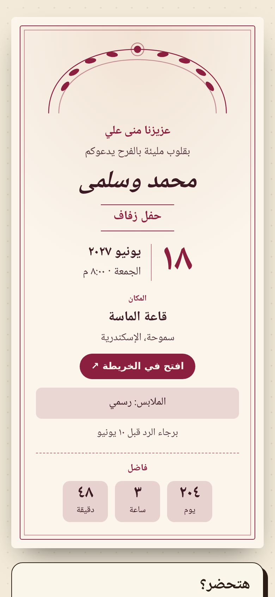
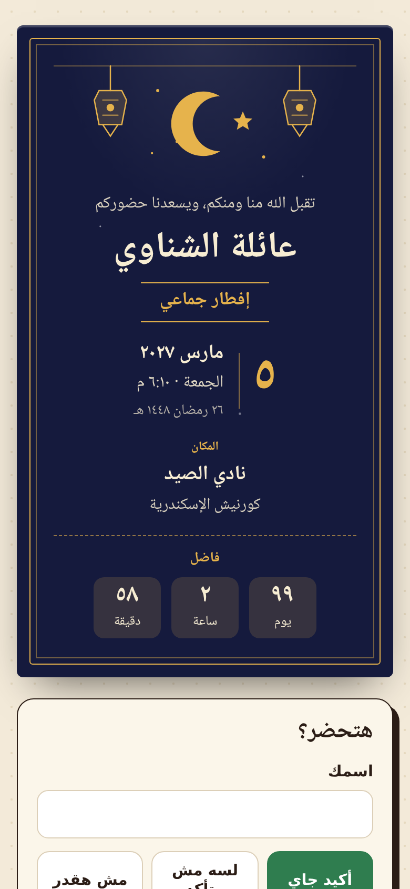
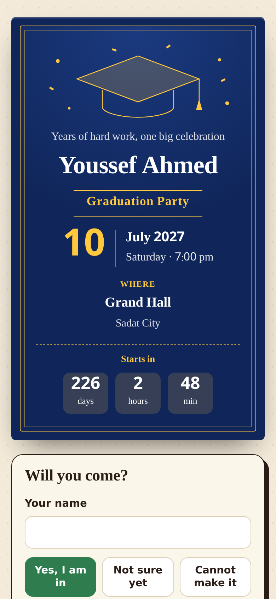
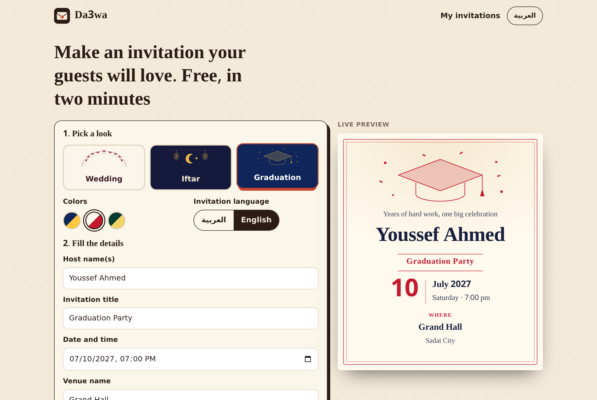
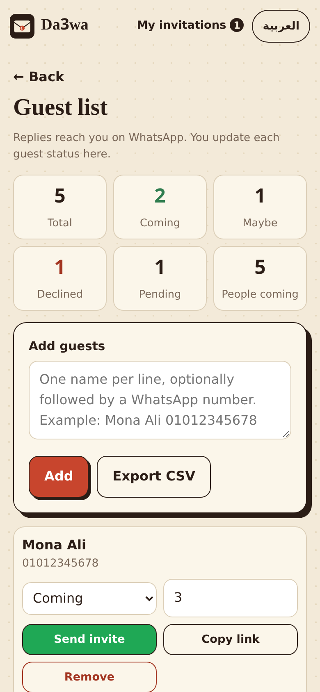
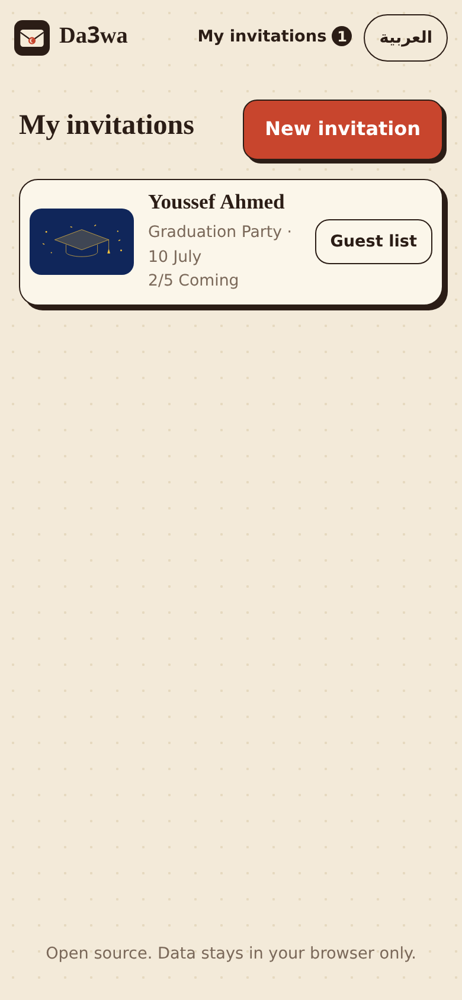

<p align="center"></p>

<h1 align="center">Da3wa | دعوة</h1>

<p align="center"><b>Pick a template, fill in the details, and get a shareable invitation page with a WhatsApp RSVP link.</b><br>
Weddings, iftar gatherings and graduations. Arabic and English, right-to-left done properly, free, no server.</p>

<p align="center"><a href="https://yousefkhames.github.io/da3wa/"><b>Open the live demo</b></a></p>

<p align="center">



</p>

## Pitch

Most people still send invitations as a screenshot and then chase replies in WhatsApp. Da3wa gives the host one link. The guest opens a proper invitation page (date, venue, map, countdown, add to calendar), taps one of three buttons, and a ready-written reply lands in the host's WhatsApp.

## Features

- **Three templates**, each with three color palettes: wedding, iftar (with optional Hijri date) and graduation. Original SVG ornaments, no stock images.
- **Arabic and English**, per invitation, with full RTL layout. The app itself switches language too.
- **Live preview** while you type, and a draft that survives a refresh.
- **Shareable link**: the whole invitation is encoded inside the URL, so there is nothing to host or sign up for.
- **WhatsApp RSVP**: guests choose coming / not sure / cannot come, set party size (with your cap) and add a note. It opens WhatsApp to your number with the message prefilled. Egyptian numbers (`01012345678`) and international formats both work.
- **Personalized links**: add guests to a list and get a link that greets each one by name, plus a one-tap "send invite" to their WhatsApp.
- **Guest list tracker**: set each guest's status and head count, see totals, export CSV (formula-injection safe).
- **Installable and offline**: a service worker and web app manifest (with icons) let you add it to the home screen and open it without a connection.
- **Countdown**, **map link**, **add to calendar** (.ics download) and **print**.
- Several invitations at once under "My invitations".
- Mobile first, keyboard friendly, respects reduced motion.

## Screenshots

<p>



</p>

## Tech

Plain HTML, CSS and ES modules. No framework, no build step, no dependencies at runtime. Data lives in `localStorage` plus the invitation link itself.

```
index.html
css/style.css
js/core.js        pure logic: encode/decode, phone, WhatsApp, ICS, guest list
js/templates.js   palettes, default copy, SVG art
js/i18n.js        Arabic and English strings
js/app.js         views and routing (hash based)
tests/            unit tests (node:test) and a real-browser click-through
```

Run it locally with any static server, for example `python3 -m http.server`, then open `http://localhost:8000`.

## Tests

```
npm test                      # 14 unit tests, no dependencies
npm i --no-save puppeteer-core
node tests/e2e.mjs http://localhost:8000/   # 27 checks in headless Chrome
```

The click-through covers validation, live preview, saving, persistence, guest list, WhatsApp links, the guest page, XSS payloads, a broken link, RTL/LTR switching and mobile overflow. The same script was run against the live GitHub Pages URL before release.

`node tests/offline.mjs <url>` checks that the service worker installs, the manifest and icons load, and the app still renders with the network switched off.

## Honest limits

- Offline support caches the app files after the first visit. Opening an invitation link for the first time still needs the app to have been loaded once online. WhatsApp links and maps need a connection, of course.
- GitHub Pages is a demo host. It is fine for trying the app, not a guarantee of uptime for a real wedding.
- There is no server, so **replies are not collected in the app**. They arrive in the host's WhatsApp, and the host updates each guest's status by hand in the guest list.
- Your saved invitations and guest list live in **this browser only**. Clearing site data or switching device loses them. The shareable link itself keeps working because it carries the invitation.
- Anyone with the link can see the invitation. Do not put private information in it.
- Links are long because they hold all the data. Messaging apps handle them fine, but they cannot be shortened without a server.
- Dates are shown in the guest's own device language and the event time is a plain local time with no time zone. The calendar file uses the same floating local time. The Hijri date comes from the browser's Umm al-Qura calendar and can differ by a day from local moon sighting.
- Fonts are system fonts, so the look varies a little between devices.

## License

MIT, see [LICENSE](LICENSE).
