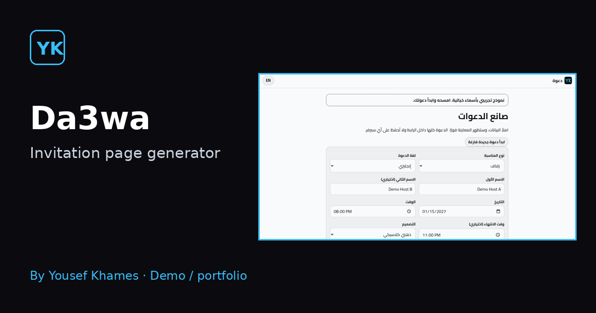

<div align="center">


# da3wa

**da3wa** · demo / portfolio project

**مولّد صفحات دعوة** · مشروع تجريبي للعرض

[Live demo](https://yousefkhames.github.io/da3wa/) · By Yousef Khames · من تطوير يوسف خميس



</div>

---

# da3wa · دعوة

A white-label invitation page generator for weddings, engagements, birthdays, graduations, aqiqa and general events. The host fills a form and gets a shareable link, a QR code and a single downloadable HTML file. Arabic RTL and English LTR. Static HTML, CSS and JavaScript. No build, account, server or API.

<div lang="ar" dir="rtl">املأ النموذج واحصل على رابط دعوة وكود QR وملف HTML واحد. كل بيانات الدعوة داخل الرابط، بدون سيرفر.</div>

 **By Yousef Khames · من تطوير يوسف خميس**

## Features

- Form: event type, host names (one or two), date, time, optional end time, venue, address, Google Maps link, dress code, message, RSVP WhatsApp number, 5 themes, invitation language.
- Live preview. The whole invitation is encoded in the link (`#/i/...`); nothing is stored on a server.
- Countdown, "Add to calendar" (`.ics`), RSVP button that opens a WhatsApp draft with the guest name and number of guests. The app only opens the draft; the guest presses send.
- Per-guest personal links (guest name in the link, prefilled in the RSVP).
- QR code, copy link, print card, download a single self-contained HTML file.
- Maps links are accepted only from Google Maps hosts. Everything the host types is escaped.

## Preview locally

```sh
python3 -m http.server 8080 --bind 127.0.0.1
```

Opens with a fictional **Demo Event** (Demo Host A and B), labelled Demo. Press "Start a blank invitation" for your own. Screenshots in `docs/` use demo data only. Links made on localhost will not work for guests; publish first.

## Configure

`config.js`: `demo` (false for a blank form), `defaultLang`. Theme and colours of the app in `assets/kit-theme.js`. Keep `assets/yk-logo.svg` and `assets/favicon.svg`.

## Deploy (GitHub Pages)

Create `yousefkhames/da3wa`, commit to `main`, Settings → Pages → Deploy from a branch → `main` / root. Live at `https://yousefkhames.github.io/da3wa/`. Create invitation links from the published page.

## Tests

```sh
npm test   # unit + review gates + headless Chrome e2e (Node 20+)
```

## Honest limits

- **No RSVP counting.** Replies arrive as WhatsApp messages and you count them yourself.
- The link carries all the text, so long text makes a long link (a warning shows above 1500 characters; very long links cannot become a QR code). Anyone who has the link can read the invitation.
- Event time has no timezone. The calendar file uses floating local time, and the countdown uses the guest's device clock and timezone.
- The downloaded HTML file uses the guest's device fonts, not Cairo. It has no links to this app.
- Invitation text is not translated: write it in the language you pick.
- Guest names in personal links are visible to anyone with that link. Do not forward one guest's link.

## License

MIT, copyright Yousef Khames. See `LICENSE`. Cairo font: SIL OFL. `assets/qrcode.js`: qrcode-generator by Kazuhiko Arase (MIT).

> Demo / portfolio project. Static GitHub Pages site with fictional sample data.
